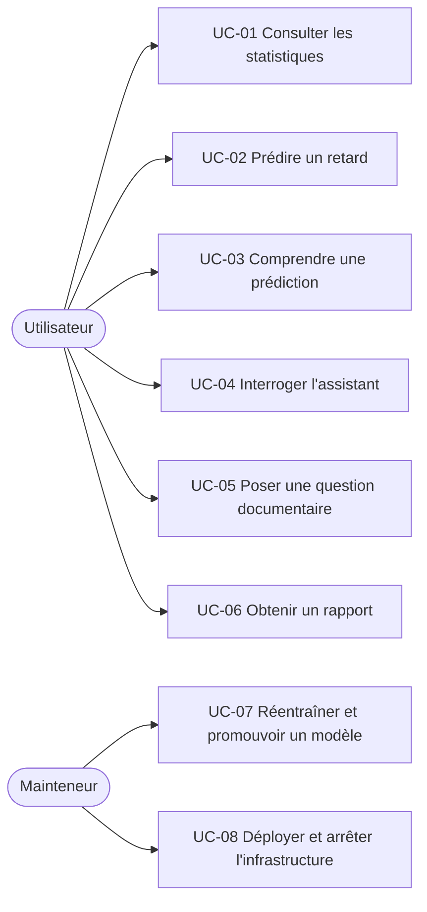

# Cas d'utilisation

## Acteurs [Hypothèse A-05]

| Acteur | Description |
|---|---|
| Utilisateur | Analyste, évaluateur ou curieux ; accède à l'application web |
| Mainteneur | Développeur qui entraîne, promeut, déploie et arrête les ressources |
| Système | Composants AWS (Lambda, SageMaker, Athena, Bedrock) |



## UC-01 — Consulter les statistiques

- **Acteur** : Utilisateur. **Exigences** : FR-15, FR-17, FR-18.
- **Préconditions** : zone analytics alimentée ; tables Athena disponibles.
- **Scénario nominal** : l'utilisateur ouvre le tableau de bord, choisit un aéroport, une compagnie ou un itinéraire et une période ; l'application affiche taux de retard, retard moyen, nombre de vols.
- **Alternatives** : échantillon sous le seuil minimal → message « données insuffisantes » ; période hors données → message indiquant la plage disponible.
- **Postcondition** : chaque chiffre affiche sa période et sa taille d'échantillon.

## UC-02 — Prédire un retard

- **Acteur** : Utilisateur. **Exigences** : FR-14, FR-16.
- **Préconditions** : endpoints actifs (voir UC-08).
- **Scénario nominal** : l'utilisateur renseigne un vol, soit en **saisie manuelle**, soit en **rejouant un vol de la période de test** (D-02, [ADR-0013](../05-decisions/adr/0013-mvp-api-usage-scope.md)) ; le backend valide, complète les variables (météo = dernière observation historique ≤ T-2h, sous condition D-01), appelle classification et régression, renvoie probabilité, décision, minutes estimées et explications.
- **Blocage possible** : si la météo à T-2h ne peut pas être reconstruite ([dataset-card.md](../dataset-card.md)), ce cas d'utilisation ne démarre pas et le blocage est signalé.
- **Alternatives** : entrée invalide → erreur 400 détaillée ; compagnie ou itinéraire inconnus de l'entraînement → prédiction avec avertissement ou refus (à décider) ; endpoints arrêtés → message de service indisponible.
- **Exemple de résultat** :

```json
{
  "delay_probability": 0.37,
  "is_delayed_predicted": false,
  "threshold": 0.42,
  "expected_delay_minutes": 6.4,
  "model_versions": {"classification": "v3", "regression": "v3"},
  "explanation": [
    {"feature": "dep_hour", "contribution": 0.08},
    {"feature": "origin_recent_delay_rate", "contribution": 0.05}
  ],
  "disclaimer": "Modèle entraîné sur des données historiques 2023–2025 (JFK, EWR, LGA, à confirmer) ; pas une prévision en temps réel."
}
```

(Valeurs illustratives, non issues de résultats réels.)

## UC-03 — Comprendre une prédiction

- **Acteur** : Utilisateur. **Exigences** : FR-11, NFR-07.
- **Scénario nominal** : après UC-02, l'utilisateur voit les variables qui augmentent ou diminuent le risque, avec la mention « influence sur le modèle, pas cause ».

## UC-04 — Interroger l'assistant

- **Acteur** : Utilisateur. **Exigences** : FR-19 à FR-22.
- **Scénario nominal** : « Quelle compagnie a le plus de retards à JFK en mars 2024 ? » (exemple de forme, sous réserve que ces aéroports et cette période existent dans le dataset vérifié) → le LLM choisit `get_airline_delay_statistics`, Lambda exécute la requête paramétrée, le LLM formule la réponse avec période et échantillon.
- **Alternatives** : question hors périmètre (ex. « mon vol d'aujourd'hui ») → l'assistant explique la limite ; paramètre invalide → l'outil renvoie une erreur et l'assistant reformule ; outil indisponible → réponse d'échec sans chiffre inventé.

## UC-05 — Poser une question documentaire [Optionnel]

- **Exigence** : FR-23. « Que signifie `is_delayed` ? » → recherche dans la base de connaissances, réponse avec le passage source. Si la question mêle définition et chiffre, l'assistant combine RAG et outil en séparant les deux sources.

## UC-06 — Obtenir un rapport

- **Exigence** : FR-22. L'utilisateur demande un rapport sur un aéroport ; l'assistant appelle les outils de statistiques puis `generate_delay_report`, qui met en forme **uniquement** les résultats reçus.

## UC-07 — Réentraîner et promouvoir un modèle

- **Acteur** : Mainteneur. **Exigences** : FR-08 à FR-13.
- **Scénario nominal** : lancer le pipeline SageMaker → métriques calculées → contrôle de qualité → si critères atteints, enregistrement dans le Model Registry → approbation manuelle → déploiement.
- **Alternative** : critères non atteints → modèle non enregistré, rapport d'échec.

## UC-08 — Déployer et arrêter l'infrastructure

- **Acteur** : Mainteneur. **Exigences** : NFR-02, NFR-04.
- **Scénario nominal** : `cdk deploy` des stacks nécessaires, création des endpoints pour la démonstration, puis suppression des endpoints (ou `cdk destroy`) après usage.

## Matrice cas d'utilisation → exigences

| UC | Exigences |
|---|---|
| UC-01 | FR-04, FR-15, FR-17, FR-18, IR-01 |
| UC-02 | FR-14, FR-16, FR-10, FR-13 |
| UC-03 | FR-11, NFR-07 |
| UC-04 | FR-19, FR-20, FR-21, NFR-06 |
| UC-05 | FR-23 |
| UC-06 | FR-22 |
| UC-07 | FR-08, FR-09, FR-12, FR-13 |
| UC-08 | NFR-02, NFR-04, FR-24 |
