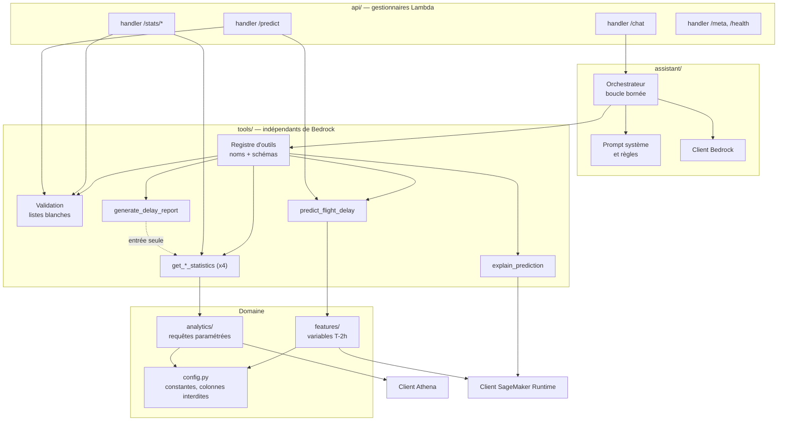
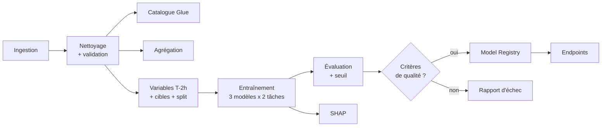

# Diagramme de composants

## Backend applicatif

Les gestionnaires HTTP (`/stats`, `/predict`) et l'assistant appellent **les mêmes outils** : une seule implémentation, un seul chemin de validation.

## Pipeline de données et ML

Voir aussi : [system-components.md](../system-components.md).
