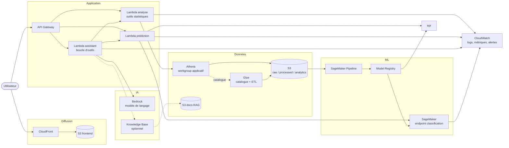

# Diagramme de conteneurs

Les unités déployables d'AeroPulse (région `us-east-1`) et leurs échanges. Les endpoints SageMaker sont temporaires (D-07).

Légende : trait plein = flux MVP ; trait pointillé = optionnel ou métadonnée.

Remarque : la boucle d'outils peut appeler les fonctions d'analyse et de prédiction en direct (appel de bibliothèque dans la même Lambda ou invocation interne). Le choix (une Lambda ou plusieurs) est un détail d'implémentation à trancher en T7 selon la taille du paquet de déploiement et les besoins d'isolation IAM.

Voir aussi : [components.md](components.md), [system-components.md](../system-components.md).
