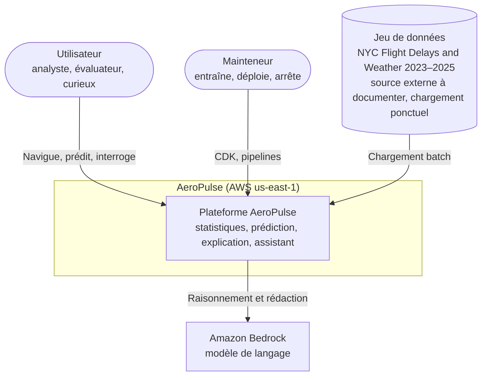

# Diagramme de contexte système

Qui interagit avec AeroPulse, et avec quels systèmes externes.

Notes :
- Aucun flux temps réel ni source externe de données de vol en MVP (extension).
- Bedrock est un service AWS mais dessiné à part car il porte une dépendance (modèle non encore choisi, disponibilité en `us-east-1`, quotas : [ADR-0012](../../05-decisions/adr/0012-bedrock-model-selection.md)).
- Les caractéristiques du dataset (JFK/EWR/LGA, 2023–2025) sont annoncées et non vérifiées.

Voir aussi : [containers.md](containers.md), [architecture-overview.md](../architecture-overview.md).
