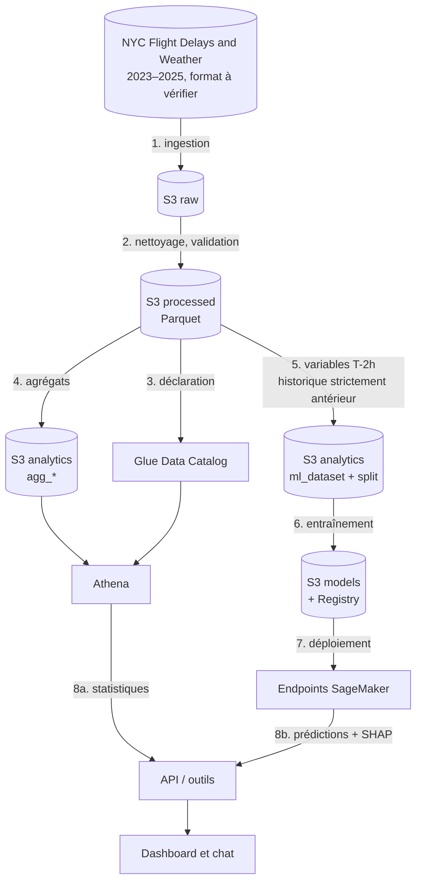
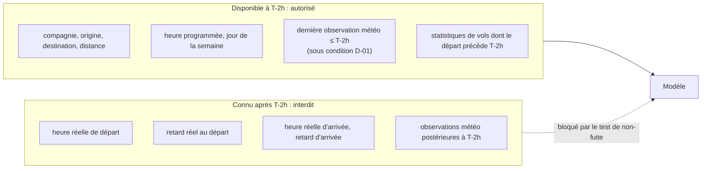
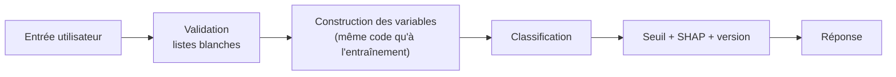

# Diagramme de flux de données

## Flux d'ensemble (batch)

## Où se situe la frontière T-2h

## Flux d'une prédiction (données)

Les statistiques historiques utilisées à la prédiction sont lues dans la zone analytics (valeurs figées à la date de fin d'entraînement) [Proposé] ; sinon une prédiction recalculerait des agrégats pendant l'appel.

Voir aussi : [er-diagram.md](er-diagram.md), [database-design.md](../database-design.md).
