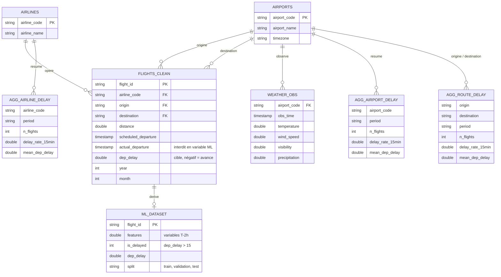

# Diagramme entité-relation (lac de données)

Colonnes **indicatives** : à confirmer à l'étape 1 (U-01) sur le dataset NYC 2023–2025, dont les 33 variables annoncées ne sont pas encore connues ([data-dictionary.md](../../data-dictionary.md)). Les noms `dep_delay` et les concepts viennent de la synthèse ; le reste est proposé. L'existence d'une table météo séparée (`WEATHER_OBS`) n'est pas établie.

Les tables `AGG_*` sont dérivées de `FLIGHTS_CLEAN` ; elles ne portent pas de clé étrangère physique (Athena n'en impose pas), la relation est logique.

Voir aussi : [database-design.md](../database-design.md).
