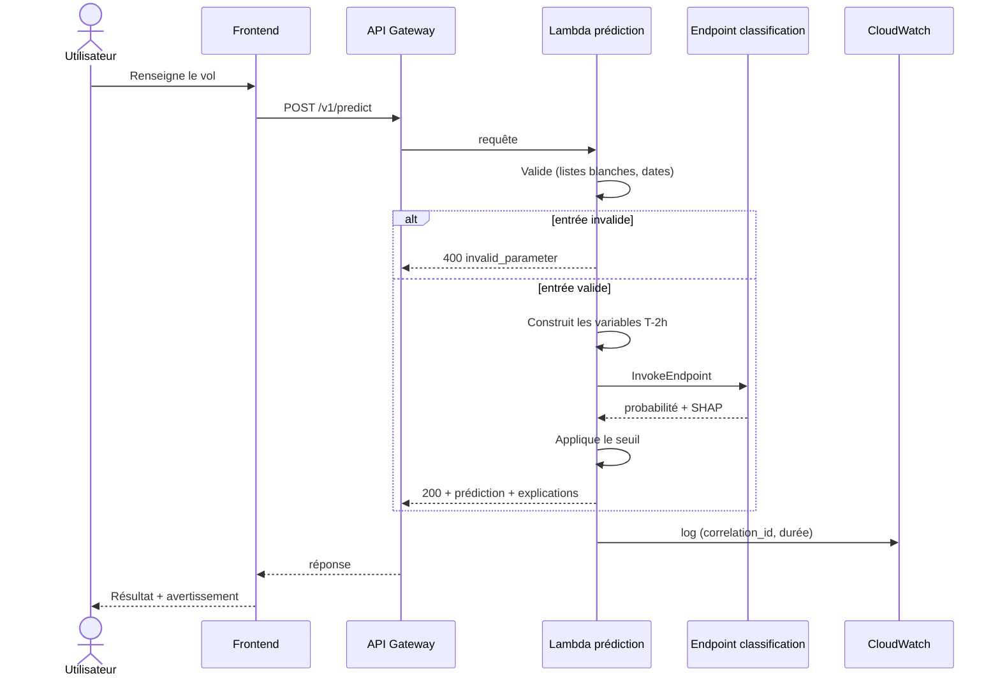
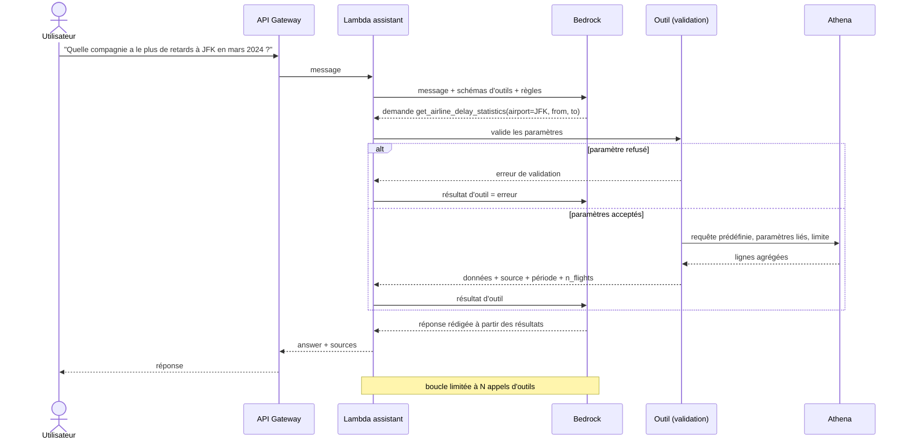
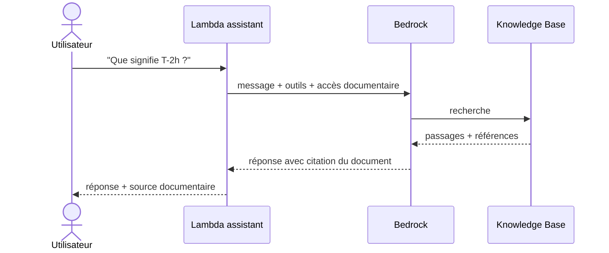
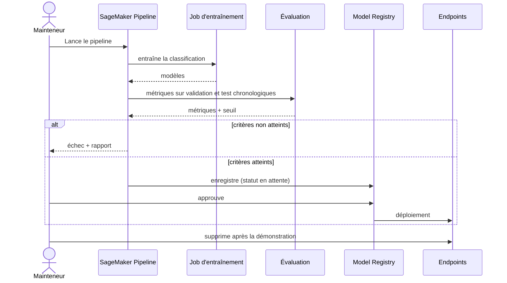

# Diagrammes de séquence

Les exemples de questions (aéroports, dates) sont illustratifs, sous réserve du contenu réel du dataset.

## 1. Prédiction (`POST /v1/predict`)

## 2. Question analytique avec Tool Calling (`POST /v1/chat`)

## 3. Question documentaire (RAG, optionnel)

## 4. Entraînement et promotion d'un modèle

