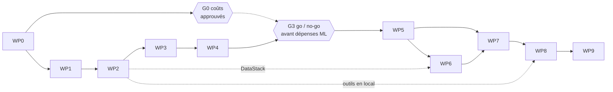

# Plan de mise en œuvre

Projet **AeroPulse**, région `us-east-1`, budget maximal 100 USD/mois, dataset NYC 2023–2025 (caractéristiques à vérifier). Les durées sont des **estimations indicatives en jours-personne** pour une personne à temps partiel [Hypothèse A-01] ; date limite et temps disponible ne sont **pas fournis** (U-03, U-08). Elles servent à comparer les lots entre eux, pas à promettre des dates. Détail des tâches : [task-breakdown.md](task-breakdown.md). Les 9 étapes de [ROADMAP.md](../ROADMAP.md) correspondent aux lots WP1 à WP9 ; WP0 (fondations) est ajouté.

## 1. Phases

| Phase | Lots | Étapes ROADMAP | Où | Objectif | Effort indicatif |
|---|---|---|---|---|---|
| A. Fondations et données | WP0, WP1, WP2 | 1, 2 | Local | Dépôt prêt, estimation de coûts approuvée, données propres, requêtes validées | ≈ 14 j |
| B. ML local | WP3, WP4 | 3, 4 | Local | Jeu sans fuite, modèles de référence expliqués | ≈ 13 j |
| C. MLOps et cloud | WP5, WP6 | 5, 6 | AWS | Modèles servis, infrastructure par code | ≈ 14 j |
| D. Application | WP7, WP8 | 7, 8 | AWS | API, dashboard, assistant | ≈ 16 j |
| E. Extensions et clôture | WP9 | 9 | AWS | RAG, monitoring, démonstration, nettoyage | ≈ 6 j |

Total indicatif ≈ 63 j, **sans marge d'aléas** : prévoir une marge supplémentaire d'au moins 20 % (A-01).

## 2. Chemin critique

Parallélisme possible :
- WP6 `DataStack` dès la fin de WP2 (indépendant des modèles).
- Outils de l'assistant (T8.2–T8.3) en local dès WP2, car ils ne dépendent pas de Bedrock.
- Squelette du frontend (T7.5) dès que le contrat d'API est figé.

## 3. Points de décision (go / no-go)

| Point | Après | Question | Si non |
|---|---|---|---|
| **G0** | WP0 | L'estimation de coûts (scénario pessimiste inclus) tient-elle dans 100 USD/mois et est-elle approuvée ? | **Aucun déploiement payant** ; revoir l'architecture (serverless, RAG, taille d'instance) |
| G1 | WP1 | Licence compatible ? Caractéristiques réelles conformes ? Horodatages météo permettant de reconstruire T-2h ? | Signaler le blocage, **aucune donnée artificielle** ; le propriétaire arbitre (autre source météo, sans météo, autre dataset) |
| G2 | WP3 | Le test de non-fuite passe-t-il et le découpage est-il valide ? | Corriger avant toute modélisation |
| G3 | WP4 | Les modèles battent-ils la baseline de façon significative ? | Revoir variables et cadrage **avant** de dépenser sur SageMaker |
| G4 | WP6 | `deploy` puis `destroy` fonctionnent-ils ? | Corriger l'IaC avant d'ajouter des services |
| G5 | WP8 | L'assistant respecte-t-il AC-14 et AC-15 ? | Ne pas livrer l'assistant ; corriger les outils et le prompt |

## 4. Plan d'activation des coûts AWS

| Phase | Ressources activées | Arrêt |
|---|---|---|
| A, B | Aucune (local) ; AWS Budgets seul (T0.6) | — |
| C (après **G0**) | S3, Glue, Athena ; jobs SageMaker ponctuels ; endpoints seulement pour les tests | Endpoints supprimés après chaque session |
| D (après G0) | API Gateway, Lambda, CloudFront, Bedrock (à la requête, modèle à vérifier) | Endpoints créés pour la démonstration uniquement |
| E (après G0) | Knowledge Base (coût de base à vérifier avant) | Supprimée après la démonstration si le coût est fixe |

Aucun coût n'est affirmé ici : voir [cost-estimate.md](../04-quality/cost-estimate.md). Les alertes AWS Budgets (50/80/100 %) ne coupent pas les dépenses : vérification régulière des ressources actives à chaque session.

## 5. Méthode de travail

- **Branches courtes** par tâche ou lot (`feat/…`, `docs/…`), fusion sur `main` par pull request, même en solo.
- **Commits** petits, message clair ; le propriétaire du dépôt réalise les commits.
- **Avant de coder un lot** : relire ses critères d'acceptation et sa liste de tâches.
- **Après chaque session** : mettre à jour [PROGRESS.md](../PROGRESS.md) (étape, prochaines actions, ressources AWS actives).
- **Décisions** : toute décision structurante crée ou met à jour une ADR dans `docs/05-decisions/adr/`.
- **Tests d'abord pour les points sensibles** : fuite de données, validation des outils, calcul des statistiques.

## 6. Définition de « terminé »

Commune à tous les lots (voir [acceptance-criteria.md](../01-planning/acceptance-criteria.md)) : critères d'acceptation vérifiés, tests passants en CI, documentation et PROGRESS.md à jour, aucune ressource AWS inutile laissée active.

## 7. Ordre de réalisation détaillé

1. WP0 — Fondations (dépôt, outils, CI, budget, estimation de coûts) ; **G0**.
2. WP1 — Exploration, source/licence, dictionnaire de données, faisabilité T-2h ; **G1**.
3. WP2 — Pipeline de préparation, agrégats, requêtes paramétrées en local.
4. WP3 — Variables T-2h, cibles, découpage, test de non-fuite ; **G2**.
5. WP4 — Baselines, modèles, évaluation, SHAP ; **G3**.
6. WP5 — Entraînement et déploiement SageMaker.
7. WP6 — CDK (DataStack tôt, le reste après WP5) ; **G4**.
8. WP7 — API et dashboard.
9. WP8 — Assistant avec Tool Calling ; **G5**.
10. WP9 — RAG, monitoring, clôture.

## 8. Hypothèses du plan

Une personne ; accès à un compte AWS (non confirmé) ; un modèle Bedrock adapté disponible en `us-east-1` (à vérifier) ; aucune échéance connue (non fournie). Si l'une de ces hypothèses est fausse, les phases C à E sont les plus sensibles ([risk-register.md](risk-register.md)).
