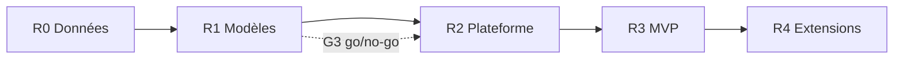

# Feuille de route par livraisons

Cette vue complète [ROADMAP.md](../ROADMAP.md) (liste stable des 9 étapes et de leurs critères de fin ; D-14 : on conserve les deux, sans dupliquer) : elle regroupe les étapes en **livraisons** et indique l'ordre **Maintenant / Ensuite / Plus tard**. L'avancement réel est suivi dans [PROGRESS.md](../PROGRESS.md). Pas de dates : la date limite et le temps disponible ne sont pas fournis (U-03, U-08).

## Livraisons

| Livraison | Contenu | Étapes | Jalon | Valeur |
|---|---|---|---|---|
| **R0 — Données** | Jeu propre, dictionnaire, requêtes SQL validées en local | 1, 2 | M1 | Base fiable |
| **R1 — Modèles** | Jeu ML sans fuite, modèles évalués et expliqués | 3, 4 | M2, M3 | Preuve que la prédiction apporte de la valeur |
| **R2 — Plateforme** | Modèles sur SageMaker, infrastructure CDK | 5, 6 | M4, M5 | Reproductibilité cloud |
| **R3 — MVP** | API, dashboard, assistant Tool Calling | 7, 8 | M6, M7 | Produit utilisable |
| **R4 — Extensions** | RAG, monitoring, dérive | 9 | M8 | Complétude |

## Maintenant / Ensuite / Plus tard

| Horizon | Éléments |
|---|---|
| **Maintenant** | WP0 sans ressource payante (dépôt, uv, CI, config) ; T0.8 estimation de coûts (G0) ; fournir source, emplacement et licence du dataset (débloque WP1) |
| **Ensuite** | WP1 (inspection, faisabilité T-2h), WP2 puis WP3 : pipeline local, variables T-2h, test de non-fuite. WP3 météo seulement si la faisabilité est établie |
| **Plus tard** | Modèles, SageMaker, CDK, API, dashboard, assistant |
| **Extensions (non planifiées)** | Flux simulés, données récentes, rapports PDF, monitoring avancé, authentification utilisateur |

## Évolutions envisagées après le MVP [Hypothèses]

| Idée | Condition |
|---|---|
| Élargir à d'autres aéroports ou à des données plus récentes | Nouvelle source de données et réentraînement |
| Interface en anglais | Après le MVP (français d'abord) |
| Remplacer l'observation météo par une prévision | Source de prévisions historiques disponible |
| Flux simulé (Kinesis/Firehose) | Présenté comme simulation uniquement |
| Rapports PDF | Après stabilisation de `generate_delay_report` |
| Authentification (Cognito) | Si l'usage dépasse la démonstration |
| Redshift | Si volume ou fréquence de requêtes le justifient |

Voir aussi : [milestones.md](milestones.md) · [implementation-plan.md](implementation-plan.md).
