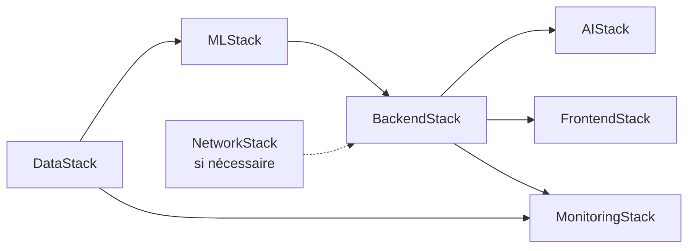

# Stratégie de déploiement

Statut : **[Proposé]**, sauf mention contraire. Principes confirmés : tout est décrit en CDK (Python) ; région `us-east-1` ; on développe en local avant d'activer des ressources payantes ; **aucun déploiement payant avant l'estimation de coûts approuvée (G0)** ; budget maximal 100 USD/mois ([cost-estimate.md](cost-estimate.md)).

## 1. Environnements

| Environnement | Usage | Contenu |
|---|---|---|
| `local` | Développement, tests, entraînement initial | Parquet + DuckDB, pas d'AWS |
| `dev` (AWS, `us-east-1`) | Intégration et démonstration | Toutes les stacks, à la demande, après G0 |
| `prod` | Non prévu en MVP | À créer seulement si l'usage le justifie |

## 2. Ordre de déploiement des stacks

Chaque stack est déployable seule ; les dépendances passent par des sorties/références explicites. `MonitoringStack` peut être déployée dès `BackendStack`.

## 3. Cycle de vie des composants coûteux

| Composant | Stratégie |
|---|---|
| Endpoints SageMaker | Créés pour tests et démonstrations, supprimés ensuite ; l'inférence serverless est à évaluer (D-07). Procédure d'arrêt écrite (T5.7) |
| Knowledge Base (optionnel) | Créée seulement pour l'évaluation/démonstration si son coût de base est fixe |
| Buckets de données | Conservés ; chiffrement, cycle de vie sur les résultats Athena |
| Lambda, API Gateway, CloudFront | Coût proportionnel à l'usage ; laissés déployés |
| Tout | Étiquettes de coût sur chaque ressource ; revue de la facture après chaque phase |

Le modèle par défaut du projet : « tout ce qui coûte en continu est éteint hors démonstration ». Les alertes AWS Budgets (50 %, 80 %, 100 %) ne coupent pas les dépenses : exécuter la checklist de contrôle des ressources actives de [cost-estimate.md](cost-estimate.md) à la fin de chaque session et avant chaque démonstration.

## 4. Pipeline de livraison (CI/CD)

| Étape | Déclencheur | Actions |
|---|---|---|
| Intégration | Pull request | Lint, typage, tests, synthèse CDK, scan de secrets |
| Déploiement `dev` | Manuel (workflow dispatch) ou fusion sur `main` | `cdk diff` visible, `cdk deploy` des stacks concernées |
| Mise en production des modèles | Manuel | Approbation dans le Model Registry puis déploiement de l'endpoint |
| Frontend | Après `FrontendStack` | Construction, envoi vers S3, invalidation CloudFront |

Authentification de la CI vers AWS par OIDC (pas de clé statique). Un seul déployeur à la fois.

## 5. Gestion de configuration et secrets

- Paramètres non sensibles : fichiers de configuration versionnés et variables d'environnement Lambda.
- Secrets : AWS Secrets Manager ou Parameter Store si nécessaire ; jamais dans le dépôt (`.env.example` ne contient que des noms).
- La région (`us-east-1`) et l'identifiant du modèle Bedrock sont des paramètres, pas des constantes ; le modèle n'est pas encore choisi ([ADR-0012](../05-decisions/adr/0012-bedrock-model-selection.md)).

## 6. Versionnement et retour arrière

| Objet | Versionnement | Retour arrière |
|---|---|---|
| Code | Git, branches courtes, étiquettes par jalon | `git revert`, redéploiement |
| Infrastructure | Stacks CDK | Redéployer la version précédente ; `cdk destroy` en dernier recours |
| Modèles | Model Registry | Redéployer une version approuvée précédente |
| Données | Préfixes versionnés dans S3 | Pointer vers le jeu précédent |
| Prompt de l'assistant | Fichier versionné dans le dépôt | Revenir à la version précédente + relancer l'évaluation |
| API | `/v1` | Conserver la version précédente tant que nécessaire |

## 7. Procédure de démonstration

1. Vérifier le budget du mois (Cost Explorer) et les ressources actives (checklist de cost-estimate.md).
2. Déployer ou confirmer les stacks nécessaires.
3. Créer les endpoints SageMaker et vérifier `/v1/health`.
4. Exécuter le scénario : UC-01, UC-02, UC-03, UC-04.
5. Supprimer les endpoints (et la Knowledge Base si applicable).
6. Mettre à jour [PROGRESS.md](../PROGRESS.md) (ressources actives = aucune).

## 8. Nettoyage complet

`cdk destroy` doit supprimer l'ensemble des stacks sans intervention manuelle (AC-12). Exceptions à documenter : buckets contenant des données à conserver (politique de rétention explicite), accès Bedrock (activation du modèle hors CDK).
