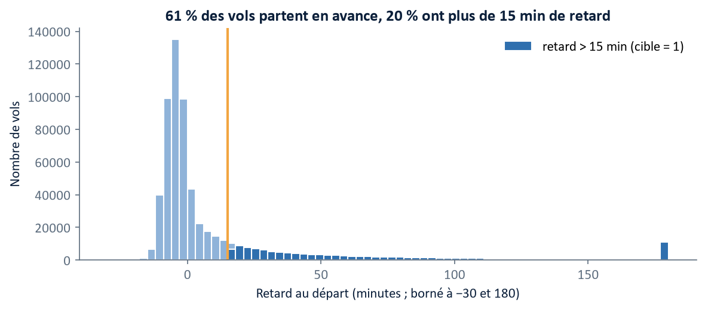
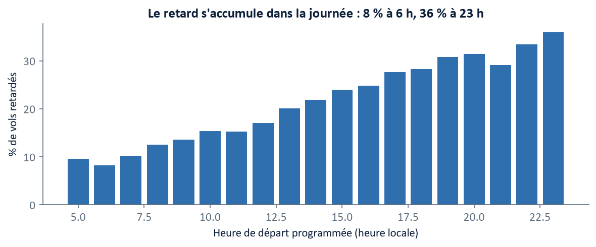
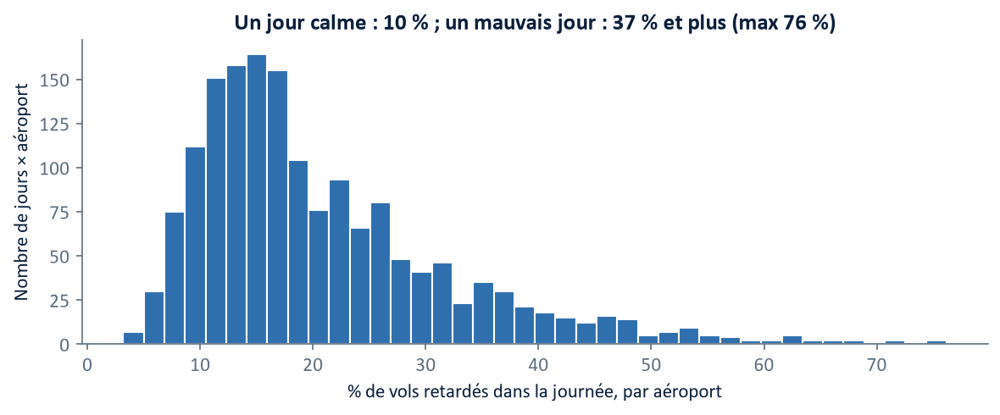
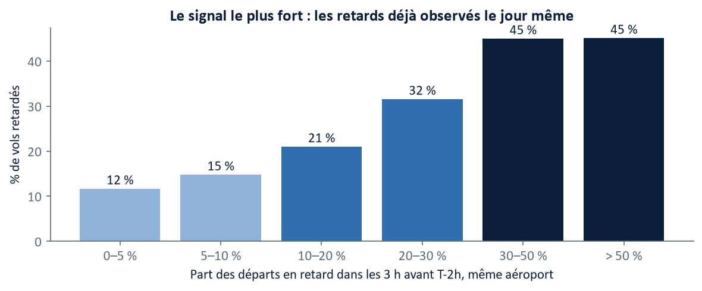
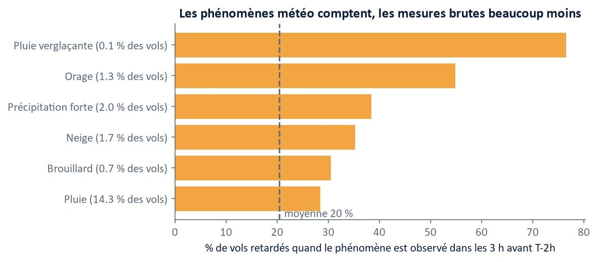
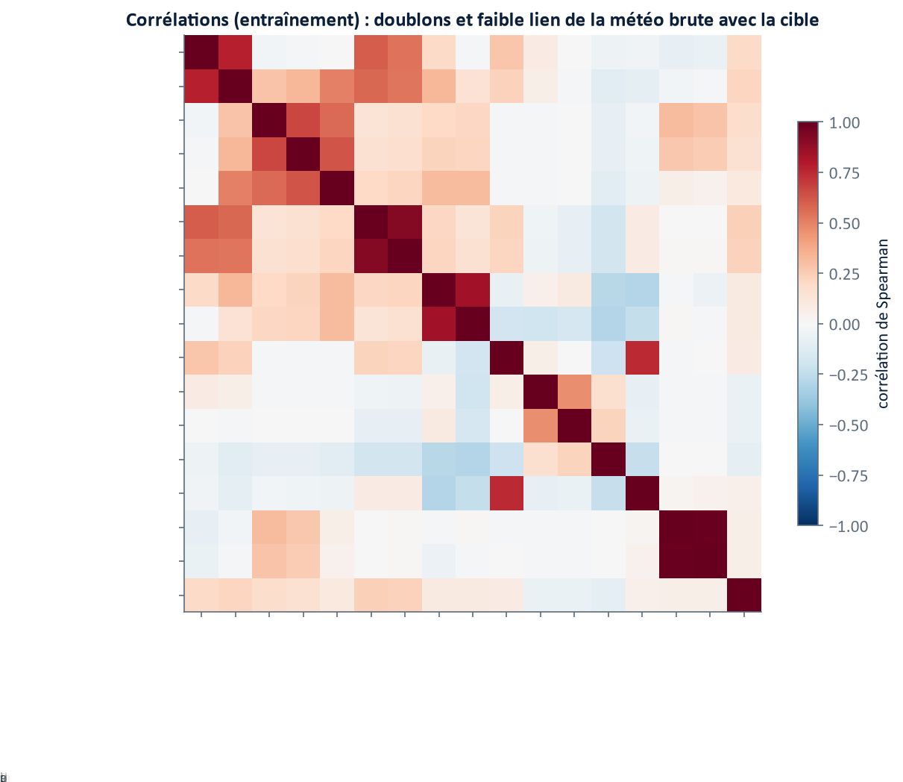
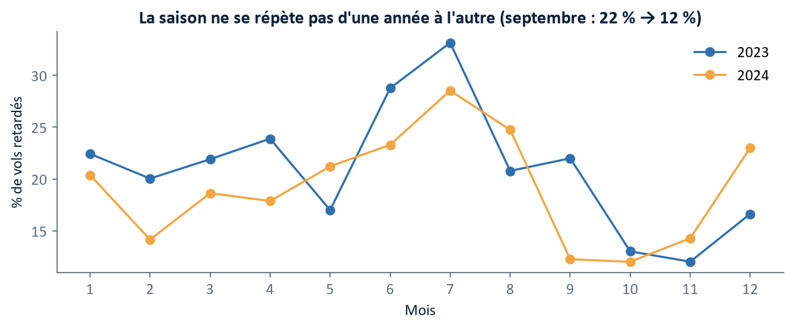
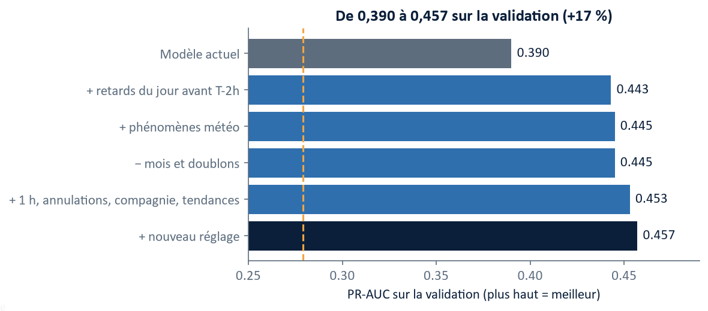

# Analyse exploratoire des données (EDA) — horizon T-2h

> Date : 2026-11-18. **Périmètre : entraînement (2023-01 → 2024-06, 621 512 vols) et validation (2024-07 → 2024-12, 205 657 vols) uniquement.** Le jeu de test 2025 a déjà servi une fois (T4.6) : ses étiquettes n'ont pas été lues ici. Les scripts sont dans [scripts/eda/](../../scripts/eda/README.md) ; les graphiques dans [eda/](eda/).
>
> Statut : **analyse et expériences terminées ; intégration des nouvelles variables en attente de décision** (voir §7).

## 1. En bref

- Le modèle actuel (PR-AUC 0,390 sur la validation) est limité surtout par **ce qu'on lui donne**, pas par l'algorithme : le réglage n'apportait que +0,008.
- Deux familles d'information manquaient : **les retards déjà observés le jour même avant T-2h** et **les phénomènes météo** (orage, neige, verglas, rafales).
- Avec ces variables, la PR-AUC de validation passe de **0,390 à 0,457 (+17 %)**, le ROC-AUC de 0,719 à 0,746, et la calibration s'améliore (écart de −0,013 à −0,005).
- La saisonnalité est instable d'une année à l'autre : la variable « mois » n'aide pas et dégrade la calibration.

## 2. La cible

| Mesure (entraînement) | Valeur |
|---|---|
| Vols retardés de plus de 15 min | 20,4 % |
| Vols partis en avance | 61,3 % |
| Médiane du retard | −3 min |
| 90e / 99e centile | 49 min / 228 min |
| Retards de plus de 60 min | 8,2 % des vols, **75 % des minutes de retard** |

La classe « retardé » est minoritaire mais pas rare : le déséquilibre n'est pas le problème (confirmé en T4.4). La distribution très asymétrique explique l'échec de la régression des minutes (ADR-0017).

## 3. Les effets principaux

| Facteur | Constat |
|---|---|
| Heure de départ | Le retard s'accumule dans la journée : 8 % à 6 h, 25 % à 16 h, 36 % à 23 h. C'est l'effet le plus régulier |
| Compagnie | De 11 % (YX, G4) à 31 % (B6) et 42 % (F9, peu de vols) |
| Aéroport | LGA 18 %, EWR 22 %, JFK 22 % |
| Jour de la semaine | Faible : de 18 % (mardi) à 23 % (dimanche) |
| Jours fériés | **Aucun effet** (20,3 % contre 20,4 %) |
| Charge programmée (départs à ± 30 min) | **Aucun effet utile** (PR-AUC seule 0,193, sous le hasard) |

## 4. Le constat central : les retards dépendent surtout du jour

Le taux de retard d'un aéroport varie énormément d'un jour à l'autre : 10 % un jour calme (10e centile), 37 % un mauvais jour (90e centile), jusqu'à 76 %. Connaître seulement « le taux de retard du jour même à l'aéroport » donnerait à lui seul une PR-AUC de 0,372, presque celle du modèle complet. Or **le modèle actuel exclut entièrement le jour même** (ses historiques s'arrêtent la veille), et son historique sur 28 jours ne suit le taux réel du jour qu'avec une corrélation de 0,41.

**Ce qui est légitimement connu à T-2h** : les vols du même aéroport **déjà partis** avant l'instant T-2h (heure réelle de départ ≤ T-2h). Leur retard est un fait observé, pas une information future.

La part de départs en retard dans les 3 heures avant T-2h fait passer le taux de retard de **12 %** (départs récents à l'heure) à **45 %** (départs récents en retard). À elle seule, cette variable atteint une PR-AUC de 0,332 : c'est la meilleure variable trouvée, au-dessus de la méthode de référence.

## 5. La météo : les phénomènes comptent, les mesures brutes peu

Les variables météo actuelles (température, vent moyen, visibilité, plafond, pression) ont toutes une corrélation inférieure à 0,1 avec la cible. Les **phénomènes** décodés du bulletin METAR (champ `REM` de NOAA, jusqu'ici inutilisé) sont bien plus parlants, quand ils sont observés dans les 3 heures avant T-2h :

| Phénomène | Retards quand présent | Part des vols |
|---|---|---|
| Pluie ou bruine verglaçante | 77 % | 0,1 % |
| Orage | 55 % | 1,3 % |
| Précipitation forte | 39 % | 2,0 % |
| Rafales > 16 m/s (max sur 3 h) | 36 % | 2,8 % |
| Neige | 35 % | 1,7 % |
| Brouillard | 31 % | 0,7 % |
| Pluie | 28 % | 14,3 % |
| (moyenne) | 20 % | — |

Diagnostic (jamais utilisé comme variable) : un orage dans les 3 h avant le **départ** donne 58 % de retards, contre 55 % s'il est vu avant **T-2h**. L'observation à T-2h perd donc peu sur ce signal ; ce qui manque surtout, c'est la météo **ailleurs** (aéroports de destination, programmes de régulation du trafic), absente du jeu de données.

## 6. Corrélations et stabilité dans le temps

- **Doublons** : distance et durée programmée (ρ = 0,99), température et point de rosée (0,84), heure et historique aéroport × heure (0,78), jour de la semaine et week-end (0,76). L'importance SHAP du « point de rosée » reflète surtout la saison.
- **Saisonnalité instable** :

Le même mois diffère beaucoup d'une année à l'autre (septembre 22 % → 12 %, décembre 17 % → 23 %, mai 17 % → 21 %). Un modèle qui apprend « le mois » apprend les particularités de 2023, d'où le décalage de calibration observé sur la validation et le test.

- **Qualité des données** : une seule durée programmée ≤ 0 ; aucune distance aberrante ; météo à T-2h disponible pour 99,96 % des vols (âge maximal 3 h, D-20).

## 7. Pourquoi les résultats étaient moyens

1. **L'information du jour même était exclue.** Les retards se propagent dans la journée (avions, équipages, régulation du trafic) ; le modèle ne voyait que la veille et les 28 jours précédents.
2. **La météo utilisée était la moins informative** : des mesures continues au lieu des phénomènes (orage, verglas, rafales).
3. **Des causes majeures sont absentes du jeu de données** : retard de l'avion à l'arrivée (numéro d'immatriculation absent), météo et congestion aux aéroports de destination, programmes de régulation de la FAA, problèmes d'équipage ou techniques. Une partie du retard est donc **imprévisible à T-2h avec ces sources** : le plafond atteignable est limité.
4. **La saisonnalité change d'une année à l'autre** ; la variable « mois » sur-apprend 2023.
5. Le réglage des hyperparamètres ne pouvait pas compenser : +0,008 seulement.

## 8. Variables testées et gains mesurés (validation)

Même modèle XGBoost, mêmes paramètres réglés, ajusté sur l'entraînement, mesuré sur la validation :

| Étape | Variables | PR-AUC | ROC-AUC | F1 | Calibration |
|---|---|---|---|---|---|
| Modèle actuel | 25 | 0,390 | 0,719 | 0,430 | −0,013 |
| + retards du jour avant T-2h (part et retard moyen sur 3 h et 18 h, nombre de départs) | 30 | 0,443 | 0,741 | 0,454 | −0,009 |
| + phénomènes météo (orage, neige, pluie, verglas, brouillard, fort, rafales sur 3 h) | 37 | 0,445 | 0,743 | 0,455 | −0,009 |
| − mois, durée programmée, week-end, point de rosée (doublons) | 33 | 0,445 | 0,742 | 0,455 | −0,003 |
| + fenêtre 1 h, annulations connues (3 h), retards de la compagnie à l'aéroport, tendances pression et visibilité | 39 | 0,453 | 0,745 | 0,457 | −0,004 |
| + nouveau réglage (profondeur 6, pas 0,05, arrêt anticipé) | 39 | **0,457** | **0,746** | 0,458 | −0,005 |

Précautions :

- La dernière ligne utilise la validation pour l'arrêt anticipé : légèrement optimiste. Les lignes précédentes ne l'utilisent pas.
- Les nouvelles variables ne lisent que des faits antérieurs à T-2h : départs **réels** ≤ T-2h, vols **annulés** dont l'heure programmée est ≤ T-2h, observations météo ≤ T-2h. Des tests de non-fuite dédiés restent à écrire lors de l'intégration.
- **Limite d'usage** : en production réelle, les retards du jour exigeraient un flux de départs en temps réel, que le projet n'a pas. Dans le cadre actuel (données historiques, mode rejeu), ils sont calculables et légitimes ; pour une saisie manuelle sur une date historique, le service peut les reconstruire depuis les données.

## 9. Ce qu'on peut encore améliorer (non testé)

| Piste | Gain attendu | Effort / risque |
|---|---|---|
| Météo des principales destinations (NOAA, gratuite : ORD, ATL, MCO, LAX…) | Possiblement important (régulations du trafic) | Téléchargement NOAA supplémentaire ; pas de nouvelle licence |
| Retards du jour **à l'aéroport de destination** (vols au départ de NYC seulement dans le jeu : non disponible) | — | Nécessiterait les données BTS complètes (licence non lue) |
| Calibration des probabilités (isotonic sur validation) | Meilleures probabilités affichées | Faible |
| Validation croisée temporelle (plusieurs coupures 2023–2024) | Choix plus robuste, moins de dépendance à une seule période | Moyen |

## 10. Plan de réentraînement proposé (à valider)

1. **Décision** : adopter les nouvelles variables dans le contrat (`config.FEATURE_COLUMNS`) — nouvelle décision et ADR, car elles introduisent des informations du jour même (antérieures à T-2h).
2. **Intégration** dans `features/` (même code pour l'entraînement et le service), avec tests de non-fuite : modifier un vol parti après T-2h ne doit rien changer ; un vol annulé après T-2h n'est pas compté.
3. **Choix du modèle par validation croisée temporelle** sur 2023–2024, sans toucher au test.
4. **Évaluation sur 2025 — point à trancher** : le test a déjà servi une fois. Options :
   - (a) **le réutiliser une seule fois**, en le signalant comme « deuxième usage » dans le rapport : comparaison directe avec 0,415, léger biais car nos choix ont été guidés par la validation et non par le test ;
   - (b) **attendre des données postérieures** (août 2025 et au-delà) pour un test vraiment neuf : nécessite une nouvelle source (BTS), au prix d'un nouveau téléchargement et de la question de licence ;
   - recommandation : (a) maintenant, (b) dès qu'une période neuve est disponible.
5. Mise à jour du service (tables de service avec les nouvelles variables), du rapport de modélisation et du contrôle de qualité D-22.
