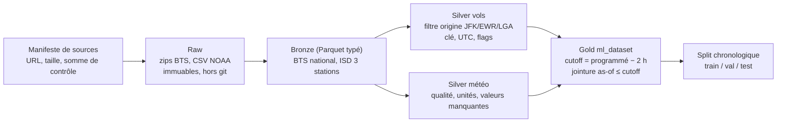

# Étude de faisabilité — acquisition du dataset (sans abonnement)

> Statut : **étude terminée, aucune implémentation.** Décision proposée dans [ADR-0016](05-decisions/adr/0016-dataset-acquisition-strategy.md), **en attente de votre approbation**. Rien n'a été téléchargé hors de l'échantillon public de 500 lignes et de quelques en-têtes de fichiers ; aucun abonnement, aucune ressource AWS.

Légende : **[V]** vérifié (source indiquée) · **[H]** hypothèse · **[?]** non résolu · **[NV]** non vérifié (annoncé par une page ou un sous-agent sans preuve directe).

Sources lues en novembre 2026 : pages publiques de mostlyright.md (catalogue, API publique, échantillon), transtats.bts.gov, fichiers publics du bucket `noaa-global-hourly-pds`, document de format ISD de NCEI, registres AWS Open Data NOAA, IEM (Iowa State). Les pages indisponibles (403/404/503) sont listées en section 9.

## 1. Constat décisif sur le dataset Mostly Right

| Fait | Statut |
|---|---|
| Le **feature cutoff** du dataset est **1 heure** avant le départ programmé : dans les 500 lignes, `scheduled_departure_utc − feature_cutoff_utc = 60 min` pour 500/500 lignes. Le catalogue dit : « latest routine observation at or before the one-hour cutoff ». | **[V]** (échantillon + catalogue public) |
| AeroPulse a fixé **T-2h** ([ADR-0003](05-decisions/adr/0003-t-minus-2h-horizon.md)). La météo du dataset (âge ≤ 59 min avant T-1h dans l'échantillon) **ne respecte donc pas le contrat T-2h** : elle est jusqu'à une heure « trop récente ». | **[V]** (déduction directe) |
| Le dataset ne contient **pas l'historique des observations météo**, seulement la dernière observation avant T-1h. On ne peut pas reconstruire « l'observation ≤ T-2h » à partir de ses colonnes. | **[V]** (33 colonnes connues) |
| Le catalogue précise : « Weather observation timestamps do not establish when reports became available. » | **[V]** (catalogue) |

**Conséquence :** même avec un abonnement et un téléchargement complet, il faudrait **retourner aux observations NOAA** pour obtenir la météo à T-2h, sauf à changer l'horizon de prédiction en T-1h (ce qui reviendrait sur ADR-0003). La reconstruction à partir des sources d'origine n'est donc pas qu'un plan B gratuit : c'est la seule voie qui respecte T-2h.

## 2. Stratégie A — échantillon gratuit Mostly Right

Échantillon récupéré par l'API publique anonyme (sans clé), **500 lignes**, 6 requêtes au plus.

### Ce qui est vérifié sur les 500 lignes [V]

| Point | Résultat |
|---|---|
| Schéma | 33 colonnes, noms identiques à ceux du catalogue |
| Période | **un seul jour : 2023-01-01** (le tri stocké est chronologique) |
| Aéroports | JFK 240, LGA 162, EWR 98 |
| Compagnies | 12 codes distincts ; 72 destinations distinctes |
| Format des valeurs | l'API anonyme renvoie **les nombres sous forme de chaînes** (ex. `"122.00"`, `"17"`), seuls les booléens et les coordonnées sont typés |
| Clé de vol | 0 doublon sur (date, compagnie, numéro, origine, destination, heure programmée) |
| UTC | `scheduled_departure_utc` = heure locale + 5 h pour 500/500 (cohérent avec l'heure d'hiver de New York en janvier) |
| Météo | 0 ligne sans météo ; **0 observation postérieure au cutoff** ; âge 0–59 min ; `weather_age_minutes` = `cutoff − weather_observed_utc` exactement |
| Stations météo | 72503014732 (LGA), 74486094789 (JFK), 72502014734 (EWR), conformes aux fichiers NOAA (section 4) |
| Retards | `departure_delayed_15` correspond à `departure_delay_minutes ≥ 15` (0 écart) |
| Annulations | 5 annulés ; 4 sans retard au départ ; **1 annulé avec un retard renseigné (49 min)** : anomalie à comprendre |
| Déroutés | 1 dérouté, avec retard au départ renseigné |
| Valeurs manquantes | `destination_name` et coordonnées de destination manquantes sur 42/500 lignes |

### Ce que l'échantillon ne permet pas

- **Il n'est pas représentatif** : un seul jour, férié, un dimanche. Taux de retard ≥ 15 min sur ce jour : 29,0 % (pas une estimation du taux global).
- **Il ne permet ni entraînement ni évaluation** de modèles, ni la vérification de la couverture mensuelle, du volume total ou des changements de comportement dans le temps.
- Il ne permet pas de vérifier la totalité des valeurs manquantes, ni les saisons, ni les cas DST (changements d'heure).

### Seuil exact de la cible

Le dataset (comme BTS) définit le retard de 15 minutes par **≥ 15** ; AeroPulse a défini `is_delayed = dep_delay > 15` (strict). Dans l'échantillon, 2 vols ont exactement 15,00 min : leur étiquette diffère selon la définition. Nous recalculerons notre cible depuis `dep_delay`.

### Usage retenu pour l'échantillon

Recette de schéma et **test de réplication** : le pipeline reconstruit doit retrouver, pour 2023-01-01, les mêmes vols, retards, heures UTC, et (avec un cutoff paramétré à 1 h) les mêmes observations météo, ce qui valide la jointure avant de passer à T-2h.

## 3. Stratégie B — BTS (vols)

Source officielle : Bureau of Transportation Statistics, table **« Reporting Carrier On-Time Performance (1987-present) »**, fichiers mensuels préformatés.

### Accès [V sauf mention]

| Point | Résultat |
|---|---|
| Page de téléchargement | `https://www.transtats.bts.gov/DL_SelectFields.aspx?gnoyr_VQ=FGJ&QO_fu146_anzr=b0-gvzr` (formulaire : champs, « Prezipped File », filtres géographie/année/mois) |
| Fichiers préformatés | répertoire `https://www.transtats.bts.gov/PREZIP/` ; exemple listé : `On_Time_Reporting_Carrier_On_Time_Performance_(1987_present)_2023_12.zip` (28 818 502 octets). **Motif résolu le 2026-11-06 par requêtes HEAD [V]** : `On_Time_Reporting_Carrier_On_Time_Performance_1987_present_<ANNÉE>_<MOIS>.zip` (sans parenthèses, mois sans zéro initial) ; les 31 fichiers 2023-01 → 2025-07 répondent 200 |
| API | **aucune API documentée trouvée** [NV : absence dans les pages lues] |
| Dernier mois disponible | août 2026 [V : page de téléchargement]. Présence de janvier 2023 à juillet 2025 : vérifiée pour la table Marketing ; pour la table Reporting, seule la présence du fichier 2023_12 est lue mot pour mot, les autres mois viennent d'un résumé du listing **[NV]** |
| Filtre par aéroport | **non disponible** sur le formulaire (filtre par état/année/mois) : filtrage par `Origin` après téléchargement. EWR est dans le New Jersey [H : donc un filtre d'état New York le manquerait] |
| Authentification | aucune [V : pages publiques] |

### Champs nécessaires [V — table Reporting Carrier, page de téléchargement]

| Besoin | Champ BTS | Description citée |
|---|---|---|
| Date | `FlightDate` | « Flight Date (yyyymmdd) » |
| Compagnie | `Reporting_Airline` | « Unique Carrier Code… » |
| Numéro de vol | `Flight_Number_Reporting_Airline` | « Flight Number » |
| Origine / destination | `Origin`, `Dest` | « Origin Airport », « Destination Airport » |
| Départ programmé | `CRSDepTime` | « CRS Departure Time (local time: hhmm) » |
| Départ réel | `DepTime` | « Actual Departure Time (local time: hhmm) » |
| Retard au départ | `DepDelay` | « Difference in minutes between scheduled and actual departure time. Early departures show negative numbers. » |
| Retard ≥ 15 | `DepDel15` | « Departure Delay Indicator, 15 Minutes or More (1=Yes) » |
| Annulé / dérouté | `Cancelled`, `Diverted` | indicateurs 1 = oui |
| Distance, durée programmée | `Distance`, `CRSElapsedTime` | miles ; minutes |
| Arrivée (interdit en variable) | `CRSArrTime`, `ArrTime`, `ArrDelay` | |
| Causes de retard (interdit en variable) | `CarrierDelay`, `WeatherDelay`, `NASDelay`, `SecurityDelay`, `LateAircraftDelay` | « Data starts 6/2003 » |
| Avion | `Tail_Number` | utile pour l'enchaînement d'avions, voir limites |

**Réponse à la question 2 :** oui, BTS fournit départ programmé, départ réel et retard au départ.

### Limites [V ou ?]

- **Heures locales uniquement**, aucun champ UTC ni fuseau [V] : conversion nécessaire. Les trois aéroports sont dans le fuseau de New York [H, cohérent avec l'échantillon : décalage de 5 h en janvier]. Les heures ambiguës (retour à l'heure d'hiver) et inexistantes (passage à l'heure d'été) exigent une règle explicite ; Mostly Right laisse l'UTC à `null` dans les cas ambigus.
- Traitement des nulls pour les vols annulés **non documenté** sur les pages lues [?]. L'échantillon montre 4/5 annulés sans retard et 1 avec retard : ne pas supposer.
- Politique de révision après première publication : **non trouvée** [?]. La page d'état des publications distingue des icônes « Revised/Filed » mais n'explique pas la politique.
- **Licence et conditions d'usage : aucun texte de licence BTS pour cette table n'a pu être lu** [V pour l'absence dans les pages lisibles ; ?] : les pages de politique BTS/DOT répondent 403. Les pages Transtats lisibles (accueil, index On-Time, historique des publications) ne contiennent ni licence ni restriction. Le guide USAGov dit que le contenu des sites fédéraux « may be subject to copyright or other restrictions » et que seules les œuvres d'agents fédéraux dans l'exercice de leurs fonctions sont des « government works » (guide général, pas un avis juridique). D'autres jeux BTS sur data.bts.gov portent « Public Domain », mais **pas la table On-Time** (non trouvée). Mostly Right parle de « public-domain assertions » [affirmation d'un tiers].
- Les noms de compagnies changent (fusions) : utiliser le code compagnie avec prudence sur plusieurs années [V : note BTS].
- `Flight_Number_Reporting_Airline` ne distingue pas les vols partagés (code share) : la clé de vol de Mostly Right (date, compagnie, numéro, origine, destination, heure) est reprise [H].

## 4. Stratégie B — NOAA (météo)

### Observations : NCEI « Global Hourly » (dérivé de l'ISD)

| Point | Résultat |
|---|---|
| Fichiers | bucket public `noaa-global-hourly-pds`, clé `YYYY/<USAF><WBAN>.csv` ; redirection depuis `ncei.noaa.gov/data/global-hourly/access/` [V] |
| Accès | HTTPS anonyme ; listing XML accessible ; pas de clé [V] |
| Région du bucket, licence | Registre AWS Open Data « NOAA Integrated Surface Database » (https://registry.opendata.aws/noaa-isd/) : `noaa-global-hourly-pds` = « ISD in CSV format », `us-east-1`, accès sans signature **[V, lu le 2026-11-06]**. Licence : voir ci-dessous. Fréquence de mise à jour : non lue [?] |
| Stations (identifiants et noms lus dans les fichiers 2024) | JFK `74486094789` « JFK INTERNATIONAL AIRPORT, NY US » ; LGA `72503014732` « LAGUARDIA AIRPORT, NY US » ; EWR `72502014734` « NEWARK LIBERTY INTERNATIONAL AIRPORT, NJ US » [V] |
| Colonnes | `STATION, DATE, SOURCE, LATITUDE, LONGITUDE, ELEVATION, NAME, REPORT_TYPE, CALL_SIGN, QUALITY_CONTROL, WND, CIG, VIS, TMP, DEW, SLP, AA1…` (environ 100 colonnes) [V : en-tête du fichier JFK 2024] |
| Horodatage | `DATE` en CSV ; le document de format dit que l'heure d'observation est « based on Coordinated Universal Time Code (UTC) » [V]. Corrélation observée : la ligne de 00:51 porte un METAR « 010051Z » [V : observation, pas une règle documentée] |
| Types de rapport | `FM-15` = METAR (routine), `FM-16` = SPECI (spécial), `FM-12` = SYNOP, plus `SOD`/`SOM` observés [V pour FM-12/15/16 : document de format] |
| Encodage | `TMP` : facteur 10, `+9999` = manquant ; vitesse du vent : facteur 10, `9999` = manquant ; plafond `CIG` : `99999` = manquant ; codes qualité 0–9 (`1` = a passé tous les contrôles, `5` = idem, source NCEI) [V : document de format] |
| Fichiers 2023 / 2024 / 2025, par station | 2023 : 8 001 276 / 8 079 148 / 7 617 650 octets (JFK/LGA/EWR) ; 2024 : 7 740 547 / 7 965 128 / 8 016 587 ; 2025 : 5 234 331 / 5 226 469 / 5 256 415 [V] — **total 63 137 551 octets ≈ 63 Mo** |
| Couverture 2025 | fichiers 2025 modifiés le 2025-10-04 ; la couverture jusqu'à fin juillet 2025 est probable mais **non vérifiée** [?] |
| API NCEI Access Data Service | existe, HTTPS GET ; l'applicabilité à `global-hourly` n'est pas confirmée par la page ; aucune limite de débit ni clé documentées [?] |
| Latence de publication, politique de révision, licence NCEI | **non trouvées** (pages 404/503) [?] |

### « Disponible à T-2h » avec des observations

Un METAR/SPECI porte l'heure de l'observation. En prenant la dernière observation dont l'horodatage est **≤ T-2h**, le décalage de publication (de l'ordre de minutes, **non documenté** dans les pages lues) est pratiquement sans effet, puisque l'on écarte tout rapport plus récent que T-2h [H]. Réserves réelles :
- les valeurs et **codes qualité** de l'ISD sont attribués après coup par NCEI ; les filtrer « quality-accepted » utilise une information qui n'existait pas à T-2h (fuite faible, à documenter) [H] ;
- l'âge de l'observation peut atteindre plusieurs heures s'il y a des trous : à mesurer, et à borner par une règle explicite (Mostly Right borne à 3 h) ;
- des rapports corrigés peuvent remplacer des rapports initiaux [?].

**Réponse à la question 3 :** NOAA fournit des observations météo avec horodatage UTC suffisantes pour reconstruire « la dernière observation ≤ T-2h » **[V : structure ; H : latence négligeable]**. Le test d'acceptation est AC-24.

### Prévisions archivées (distinction essentielle)

Les observations ne sont **pas** des prévisions. Ce que les sources lues disent des **prévisions** :

| Source | Officielle NOAA ? | Couverture 2023-01→2025-07 | Accès | Verdict |
|---|---|---|---|---|
| TAF via IEM (Iowa State) | **Non** (miroir universitaire) | date de début **non trouvée** | CSV par station et fenêtre d'émission ; modalités « as-is », utilisable « pour tout usage licite » | Piste de faisabilité à tester, qualité d'archive non garantie |
| Archive TAF officielle NCEI | — | **non trouvée** | — | Non établie |
| GFS sur AWS (`noaa-gfs-bdp-pds`) | Oui | **fenêtre glissante de 30 jours** | sans compte | **Inutilisable** pour 2023–2025 |
| GFS NCEI 0,5° / 1,0° | Oui | depuis 2005–2006 ; « approx. two years to present online » (ambigu) | HTTPS/THREDDS | Grilles lourdes, pas de 0,25°, délai d'archivage ambigu |
| HRRR sur AWS (`noaa-hrrr-bdp-pds`) | Oui | « since 2014 » | sans compte, grilles complètes | Faisable en théorie mais très lourd (grilles), pas d'API de point |
| NBM sur AWS | Oui | début **non trouvé** ; rétention **non claire** (« 1-2 days » pour certains fichiers) | sans compte | Non établi |
| GFS MOS / LAMP sur NOMADS | Oui | archive **non trouvée** | serveur opérationnel | Non établi comme archive |

**Réponse à la question 4 :** des prévisions archivées gratuites existent peut-être (TAF via IEM, HRRR sur AWS, GFS sur NCEI) mais **aucune n'est vérifiée comme complète, légère et officielle** pour 2023–2025. Aucune ne sera supposée. Les prévisions sont donc **hors du MVP** ; une piste d'extension est un spike limité sur TAF/IEM et HRRR (voir ADR-0016). L'option A (dernière observation ≤ T-2h) reste la décision D-01.

### Licence NOAA ISD / Global Hourly [V, lu le 2026-11-06]

- Registre AWS (entrée ISD, qui référence `noaa-global-hourly-pds`) : « NOAA data disseminated through NODD are open to the public and can be used as desired. » ; « NOAA requests attribution for the use or dissemination of unaltered NOAA data. » ; « it is not permissible to state or imply endorsement by or affiliation with NOAA » ; « If you modify NOAA data, you may not state or imply that it is original, unaltered NOAA data. » Citation suggérée : « NOAA Integrated Surface Database (ISD) was accessed on DATE from https://registry.opendata.aws/noaa-isd ».
- Fiche NCEI (version « superseded »), contraintes d'usage : citation « NOAA National Centers for Environmental Information… » et clauses de non-garantie ; téléchargements « in most cases… free ».
- **Seule restriction trouvée** (readme NCEI de 2016) : « The non-U.S. data in ISD are subject to WMO Resolution 40 restrictions, and cannot be redistributed to other users or customers. » Elle vise les données **non américaines** ; nos trois stations sont américaines (JFK, LGA, EWR). Son application aux copies S3 n'est pas précisée.
- Aucune page de « politique d'accès aux données » NCEI n'a été trouvée.

## 5. Volumes, effort, stockage

| Élément | Taille / effort | Statut |
|---|---|---|
| BTS : 31 archives mensuelles (2023-01 → 2025-07) | **900 608 820 octets** au total (24 730 977 à 34 427 174 octets par fichier) | **[V]** : en-têtes `Content-Length` lus par HEAD le 2026-11-06 (`python -m aeropulse.data.download`, dry-run) ; sommes de contrôle à calculer au téléchargement |
| BTS décompressé (CSV national) | **non mesuré** | [?] |
| NOAA : 9 fichiers CSV (3 stations × 2023–2025) | 63 137 551 octets ≈ 63 Mo | **[V]** |
| Résultat (≈ 1,06 M vols × ~35–40 colonnes en Parquet) | **non mesuré** ; l'ordre de grandeur doit être confirmé par construction | [?] |
| Nombre de téléchargements | 31 + 9 = 40 fichiers, tous par HTTP direct | [V] pour NOAA, [H] pour la répétabilité BTS |
| Coût AWS | **0 USD** : tout est local ; aucun service AWS n'est requis pour acquérir ou transformer | [V] |
| Espace disque local | quelques Go suffisent probablement (zips ≈ 0,9 Go + CSV décompressés + Parquet) ; à confirmer | [H] |
| Effort | 2–4 jours-personne pour l'acquisition, le pipeline et les contrôles (estimation, A-01) | [H] |

Les fichiers bruts ne vont ni dans git ni sur AWS tant que G0 n'est pas franchi.

## 6. Comparaison des schémas

| Colonne Mostly Right | Source d'origine | Reconstructible ? | Remarques |
|---|---|---|---|
| `flight_date`, `carrier`, `flight_number`, `origin`, `destination` | BTS | Oui [V] | `carrier` = `Reporting_Airline` ; `flight_number` = `Flight_Number_Reporting_Airline` |
| `scheduled_departure_hhmm`, `departure_hour`, `month`, `day_of_week` | BTS `CRSDepTime`, `FlightDate` | Oui | `departure_hour` dérivé |
| `scheduled_elapsed_minutes`, `distance_miles` | BTS `CRSElapsedTime`, `Distance` | Oui | |
| `departure_delay_minutes`, `arrival_delay_minutes`, flags 15 min, `cancelled`, `diverted` | BTS `DepDelay`, `ArrDelay`, `DepDel15`, `ArrDel15`, `Cancelled`, `Diverted` | Oui | résultats observés, **jamais en variable** |
| `scheduled_departure_utc` | BTS local + fuseau | Oui avec règle DST | Mostly Right laisse `null` pour les heures ambiguës |
| `feature_cutoff_utc` | dérivé | Oui | **à recalculer à T-2h** (leur valeur est T-1h) |
| `origin_name`, `origin_*`, `destination_*` | OurAirports (selon Mostly Right) | Probablement, source non vérifiée par nous [?] | métadonnées « current, not historical » ; trouées pour la destination (4 % des vols sur l'ensemble) |
| `weather_station` | ISD (station) | Oui [V] | 3 stations vérifiées |
| `weather_observed_utc`, `weather_age_minutes`, `temperature_c`, `dewpoint_c`, `wind_speed_mps`, `visibility_m`, `ceiling_m` | ISD `DATE`, `TMP`, `DEW`, `WND`, `VIS`, `CIG` | Oui, **avec cutoff T-2h** | conversions d'unité et filtre qualité à définir |

Variables absentes de Mostly Right **mais disponibles à la source** [V pour l'existence des colonnes] : pression (`SLP`), précipitations (`AA1`…), `REPORT_TYPE`, causes de retard BTS (interdites), numéro d'avion (`Tail_Number`).

Variables **impossibles** avec les sources gratuites vérifiées : prévisions météo archivées (section 4), horaires de portes, trafic réel à l'instant T, état de l'avion en amont (partiellement dérivable des vols précédents via `Tail_Number` [H], strictement avant T-2h).

## 7. Limites qui touchent les objectifs ML

| Limite | Effet | Réponse |
|---|---|---|
| Météo = observation, pas prévision | Signal plus faible que ce que verrait un utilisateur réel à T-2h | Affichée comme limite ; extension prévisions |
| Heures locales BTS | Risque d'erreur DST et de cutoff | Règle explicite, tests DST |
| Annulations/déroutages | Ne sont pas des retards ; `DepDelay` parfois null/incohérent | Décision D-19 : proposition d'exclure des cibles, conserver en statistiques descriptives |
| Seuil ≥ 15 vs > 15 | Définitions différentes de `is_delayed` | Calculer depuis `DepDelay` |
| Qualité ISD attribuée après coup | Fuite faible | Documenter ; envisager un filtre minimal |
| Dérive 2023 → 2025 | Test sur 2025 (partiel) | ADR-0004 |
| Licence | Utilisation dans le dépôt/rapports | Lire les politiques BTS/NOAA avant publication des données ; ne pas redistribuer les fichiers bruts |

## 8. Pipeline ETL proposé (non implémenté)

Local d'abord, Python + Parquet ; pandas/PyArrow pour ce volume, DuckDB pour les contrôles SQL ; PySpark/Glue seulement ensuite (coût à estimer, G0). **Ces bibliothèques ne sont pas installées dans l'environnement actuel** (installation prévue en WP0 via uv).

| Étape | Contenu | Contrôles bloquants |
|---|---|---|
| Manifeste | liste des 31 + 9 fichiers, URL, taille, somme de contrôle, date de téléchargement | tailles et sommes de contrôle consignées |
| Raw | copie sans modification | nombre de fichiers = attendu |
| Bronze | lecture typée, nommage stable | schéma attendu, aucune colonne inconnue |
| Silver vols | filtre `Origin` ∈ {JFK, EWR, LGA}, exclure non domestique/sans origine, clé de vol, conversion UTC, `cutoff = programmé − 2 h` | 0 doublon de clé ; décomptes mensuels |
| Silver météo | codes qualité, valeurs manquantes (`+9999`, `99999`…), unités, type de rapport (choix FM-15 seul ou FM-15+FM-16) | plages physiques |
| Gold | jointure **as-of** observation la plus récente ≤ cutoff, même aéroport, âge borné ; cibles ; variables historiques strictement antérieures | tests de non-fuite (AC-03/04), AC-24 |
| Split | dates exactes selon couverture réelle | monotonie du temps |

## 9. Tests de qualité et de validité temporelle (à écrire avant l'ETL)

1. **Complétude** : 31 mois présents ; nombre de vols par mois ; comparaison avec les chiffres publiés par Mostly Right (1 056 897 au total, moyenne 34 093 par mois) — ce sont des **valeurs affichées par le tiers**, pas une vérité [NV].
2. **Clé** : 0 doublon de (date, compagnie, numéro, origine, destination, heure).
3. **Domaines** : heures hhmm valides, plages de retard plausibles, indicateurs cohérents avec `DepDelay`.
4. **Fuseaux et DST** : toutes les heures programmées ont un UTC unique, ou sont marquées `null` ; cas de janvier, mars et novembre testés.
5. **Cutoff** : `programmé_utc − cutoff = 120 min` exactement.
6. **Jointure météo** : aucune observation postérieure au cutoff ; âge ≤ borne ; taux de vols sans météo mesuré et documenté ; observation du bon aéroport.
7. **Test de réplication** (échantillon du 2023-01-01) : avec cutoff 60 min, retrouver les 500 lignes (clés, retards, UTC, observations) ; écarts expliqués.
8. **Non-fuite** : aucune colonne interdite dans les variables ; statistiques historiques strictement antérieures à T-2h.
9. **Split** : toute date de validation > toute date d'entraînement ; idem test ; effectifs suffisants.
10. **Stabilité** : distributions (taux de retard, saisons) entre train/validation/test, pour documenter la dérive.

## 10. Peut-on soutenir classification et régression ?

| Tâche | Verdict | Conditions |
|---|---|---|
| Classification `dep_delay > 15` | **Oui** (signal et étiquettes disponibles, ordre de grandeur du million de vols annoncé, non vérifié) | Cible recalculée ; exclusion/gestion des annulés ; PR-AUC et seuil sur validation (ADR-0015) |
| Régression `dep_delay` (minutes, négatifs conservés) | **Oui** | Distribution lourde à droite à documenter ; MAE/RMSE ; baselines |
| Contrat T-2h | **Oui** avec observations ≤ T-2h | AC-24 |
| Objectif « prévision » météo | **Non** dans le MVP | Extension |

## 11. Questions non résolues

1. Licence formelle de la table BTS On-Time (aucun texte lu, pages de politique en 403) ; application éventuelle de la restriction WMO Résolution 40 aux copies S3 (visant les données non américaines). NOAA ISD : licence ouverte avec attribution lue (voir §4).
2. ~~Motif exact des noms de fichiers BTS et tailles~~ : résolu le 2026-11-06 (HEAD). Reste : contenu réel des archives (décompressé, colonnes) à lire après téléchargement.
3. Couverture des fichiers NOAA 2025 jusqu'à fin juillet.
4. Traitement des vols annulés dans BTS (cas du vol annulé avec retard de 49 min dans l'échantillon).
5. Latence de publication des observations (non documentée).
6. Disponibilité réelle, début de couverture et licence des TAF IEM ; viabilité de HRRR (grilles) pour les prévisions.
7. Le dataset Mostly Right est-il reproductible exactement ? (règles de jointure : « routine » = FM-15 seul ?)

## 12. Pages inaccessibles lors de l'étude

Politiques BTS/DOT (403), registre AWS Global Hourly (404), page produit NCEI (404), métadonnées ISO NCEI (503), politique d'accès NCEI (404), page de requête TAF IEM (404). Ne pas considérer ces absences comme des preuves d'absence.

Liens : [dataset-card.md](dataset-card.md) · [data-dictionary.md](data-dictionary.md) · [ADR-0016](05-decisions/adr/0016-dataset-acquisition-strategy.md) · [decisions-pending.md](05-decisions/decisions-pending.md)
